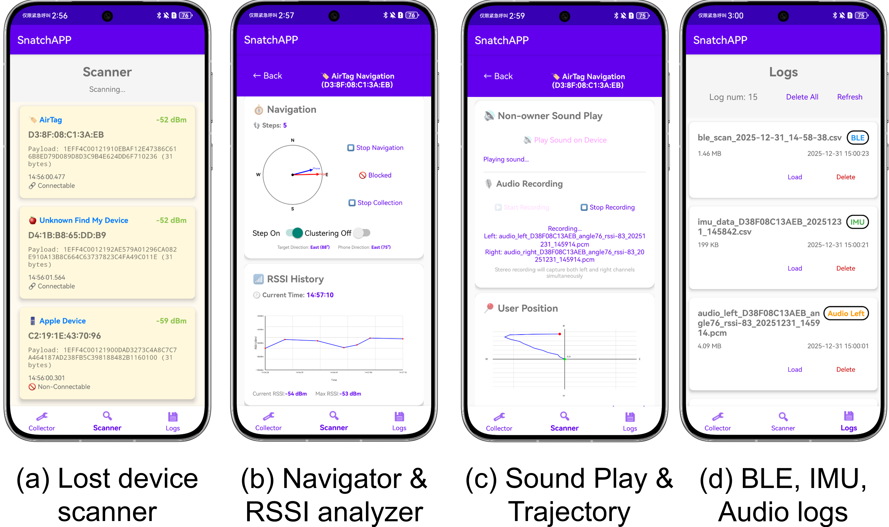
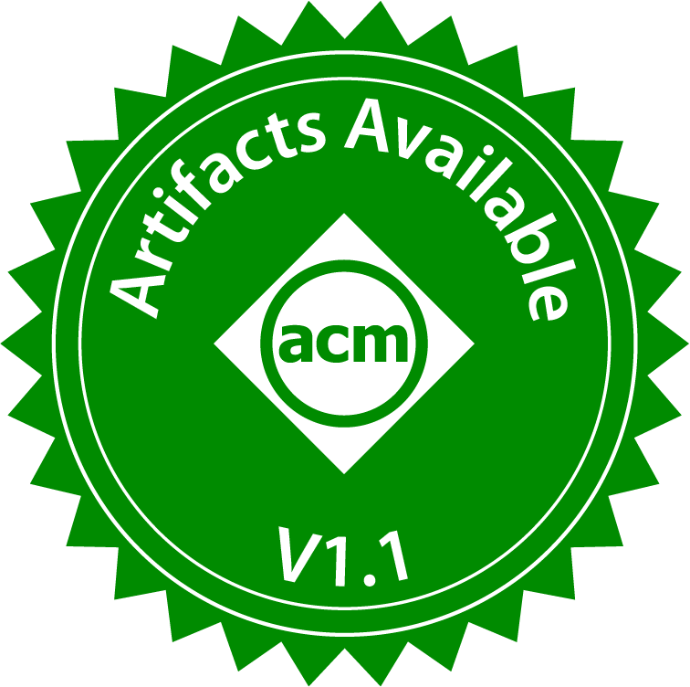
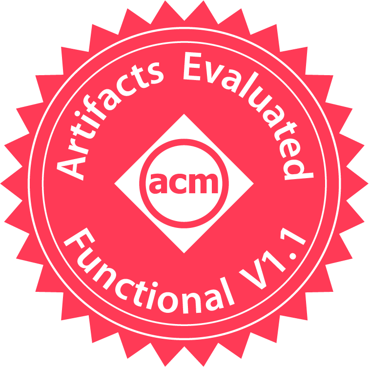
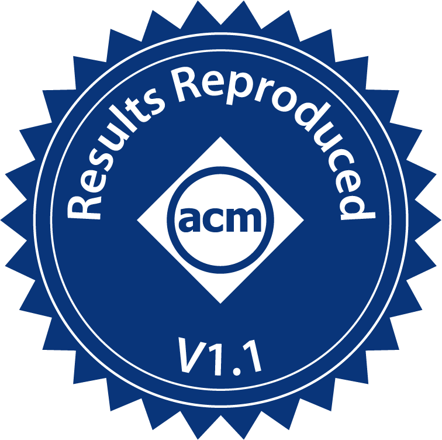
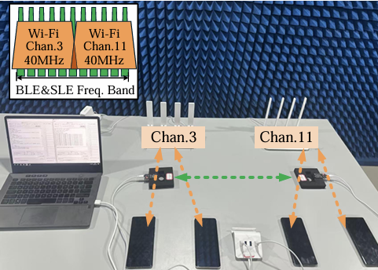
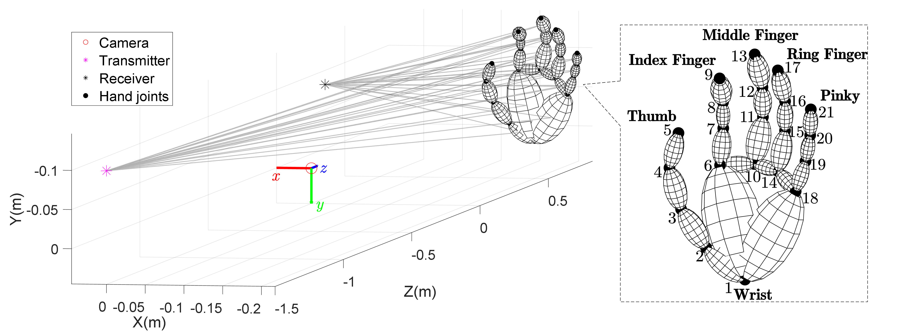
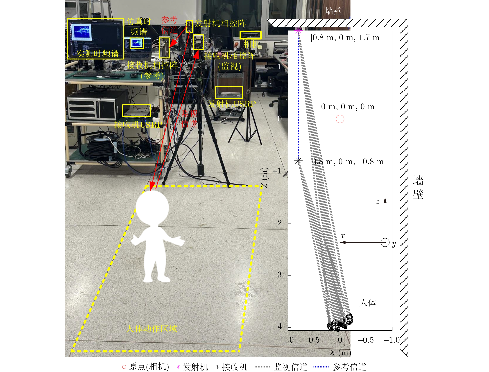

<!-- <strong>⚠ This page is outdated and will not be maintained until job hunting | 此简历在找工作前不再更新. (2025-09-24)</strong> -->
⚠ INFO: This page might be outdated.

## Resume for Zhenyu Ren (任振裕) [[CV.pdf]](/cv.assets/CV.pdf)

  
  

Zhenyu Ren

  <ul>
    <li>
       Email: <a href="mailto:zrenax@connect.ust.hk">zrenax@connect.ust.hk</a>;  
       Website: <a href="https://renzhenyu.site">https://renzhenyu.site</a>;  
       Github: <a href="https://github.com/rzy0901">https://github.com/rzy0901</a>.
    </li>
    <li>
      I am a Ph.D. student in the Department of Computer Science and Engineering at
      <strong>Hong Kong University of Science and Technology (HKUST)</strong>,
      supervised by <strong><a href="https://home.cse.ust.hk/~lim/">Prof. Mo Li</a></strong>.
    </li>
    <li>
      My research interests focus on: Short-range Wireless Communication Protocols & Security (Nearlink, BLE, Wi-Fi).
    </li>
  </ul>

## Education

+ <b>Hong Kong University of Science and Technology | Ph.D. Student</b> <i style="float: right">September 2025 – Present</i>

  Computer Science and Engineering, supervised by Prof. [Mo Li](https://home.cse.ust.hk/~lim/).

+ <b>Southern University of Science and Technology | Master</b> <i style="float: right">September 2022 – June 2025</i>

  Electronic Science and Technology, supervised by Prof. [WANG Rui](https://ieeexplore.ieee.org/author/37089502484).

+ <b>Southern University of Science and Technology | Bachelor</b> <i style="float: right">September 2018 – June 2022</i>

  Communication Engineering, supervised by Prof. [WANG Rui](https://ieeexplore.ieee.org/author/37089502484).

## Experience

+ <b>Huawei Technology, Huawei Hong Kong Research Center (HKRC) | Part-time Research Intern</b> <i style="float: right">June 2026 – Present</i>

  Working on the **SparkLink Low Energy (SLE)** protocol for multi-device collaboration in HarmonyOS.

+ <b>Huawei Technology, Computer Network and Protocol Research Laboratory | Research Intern</b> <i style="float: right">July 2024 – January 2025</i>

  Worked on **Nearlink (Sparklink)** protocol. Internship Certificate: [[pdf]](/cv.assets/intern_huawei_proof2.pdf).

+ <b>Huawei Technology, Wireless Technology (WT) Laboratory | Research Intern</b> <i style="float: right">June 2021 – June 2022</i>

  Worked on wireless sensing. Supervised by Dr. [Tony HAN Xiao](https://scholar.google.com/citations?hl=en&user=cqvSehcAAAAJ) (Chair of IEEE 802.11bf). Internship Certificate: [[pdf]](/cv.assets/intern_huawei_proof.pdf).

## Publications & Patents

### Publications

  

    
ACM CCS 2026

    
    
Keywords: Apple Find My network, BLE advertisement security, lost-device tracking, physical theft.

  

  

  
<strong>Zhenyu Ren</strong>, Yanbo Zhang, Boya Liu, and Mo Li. "Snatcher: Apple Find My Network Exposes Your Lost Devices To Strangers," in <i>Proceedings of the 2026 ACM SIGSAC Conference on Computer and Communications Security (CCS)</i>, 2026.  
  <a href="https://arxiv.org/abs/2606.21067">[Paper]</a> | <a href="https://github.com/rzy0901/Snatcher">[GitHub]</a> | <a href="https://wands-hkust.github.io/Snatcher/">[Project Page]</a> (with 1 video demo).  
  
  

  

  

    
ACM TIOT 2026

    
    
Keywords: SparkLink Low Energy, Nearlink, BLE, comparative measurement study.

  

  

  
Boya Liu*, <strong>Zhenyu Ren*</strong>, Yanbo Zhang, Mo Li, Jiaxin Liang, Bin He, Jie Li, Hao Wu, and Jingbin Zhou. "Unveiling SparkLink Low Energy: A Comparative Measurement Study," <i>ACM Transactions on Internet of Things</i>, vol. 7, no. 1, Article 6, February 2026. (Co-first author)  
  <a href="https://doi.org/10.1145/3776559">[Paper]</a>
  

  

  

    
IEEE OJ-COMS 2024

    
    
Keywords: Wireless hand gesture recognition, channel model, simulation-to-reality inference, mmWave system.

  

  

  
<strong>Zhenyu Ren</strong>, Guoliang Li, Chenqing Ji, Chao Yu, Shuai Wang, and Rui Wang. "CASTER: A Computer-Vision-Assisted Wireless Channel Simulator for Gesture Recognition," in <i>IEEE Open Journal of the Communications Society</i>, vol. 5, pp. 3185–3195, 2024.  
  <a href="https://doi.org/10.1109/ojcoms.2024.3398016">[Paper]</a> | <a href="https://github.com/rzy0901/testSpectrogram">[GitHub]</a> | <a href="https://lasso-sustech.github.io/CASTER/">[Project Page]</a> (with three video demos).
  

  

  

    
Journal of Radars

    
    
Keywords: Millimeter wave, human motion recognition, computer vision, channel simulation.

  

  

  
<strong>REN Zhenyu</strong>, JI Chenqing, YU Chao, et al. "Computer Vision-Assisted Wireless Channel Simulation for Millimeter Wave Human Motion Recognition," <i>Journal of Radars</i>, 2025, 14(1): 90–102.  
  <a href="https://doi.org/10.12000/JR24101">[Paper]</a>
  

  

### Patents

+ **任振裕**，陈万里，王锐，余潮，"无线信道仿真方法、装置、计算机设备及存储介质"，专利申请号：2023110356420，南方科技大学，申请日：2023.08.16（发明专利）。

<!-- ## Awards

+ 2023年广东省挑战杯省级二等奖；
+ 2023年校级攀登计划负责人（经费：2万元）；
+ 2022年南方科技大学电子系优秀毕业生；
+ 2022年南方科技大学致仁书院优秀毕业生；
+ 南方科技大学优秀学生三等奖学金（2次）；
+ 2020年全国大学生数学建模大赛省级一等奖； -->

LAST UPDATED: September 2026
